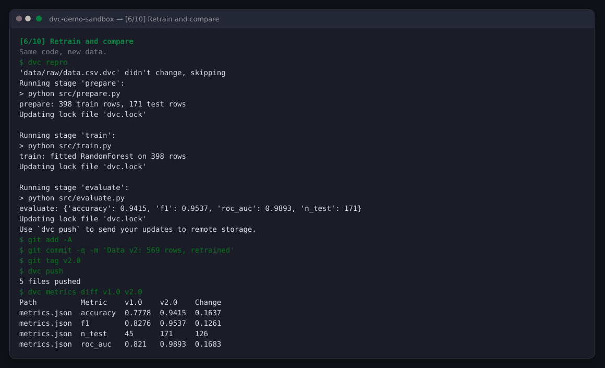

# DVC – Data Versioning Demo

A small, complete example of **[DVC (Data Version Control)](https://dvc.org)** on an ML task:
a breast-cancer classifier whose training data changes over time.

The demo shows how DVC lets you:

- **Version datasets** next to your code, without putting large files in Git
- **Define a reproducible pipeline** (`prepare → train → evaluate`) that re-runs only what changed
- **Compare metrics** between data versions (`dvc metrics diff v1.0 v2.0`)
- **Time-travel** back to an old dataset and model with `git checkout` + `dvc checkout`
- **Share and recover** data through remote storage (`dvc push` / `dvc pull`)
- **Run experiments** on hyperparameters without new commits (`dvc exp run`)

## The story

| Version | Data | Rows | Test accuracy |
|---|---|---|---|
| `v1.0` | Early snapshot, ~13% noisy labels | 150 | 0.78 |
| `v2.0` | Full, cleaned dataset | 569 | 0.94 |

Same code, same parameters. Only the data changed, and DVC records exactly which data produced which model.

## Project structure

```
.
├── src/
│   ├── make_dataset.py   # simulates raw data arriving (v1, then v2)
│   ├── prepare.py        # stage 1: train/test split
│   ├── train.py          # stage 2: RandomForest
│   └── evaluate.py       # stage 3: metrics.json + confusion-matrix data
├── dvc.yaml              # the pipeline (stages, deps, params, outputs)
├── params.yaml           # hyperparameters tracked by DVC
├── demo/run_demo.py      # step-by-step live demo runner
├── docs/
│   ├── screenshots/      # backup screenshots of every demo step
│   └── demo_transcript.md
└── requirements.txt
```

## Setup

Requires **Python 3.9+** and **Git**.

```bash
git clone https://github.com/ayah-hussain/dvc-data-versioning-demo.git
cd dvc-data-versioning-demo

python -m venv .venv
source .venv/bin/activate          # Windows: .venv\Scripts\activate
pip install -r requirements.txt

dvc --version                      # should print 3.67.1
```

## Run the demo

```bash
python demo/run_demo.py            # interactive: press Enter before each step
python demo/run_demo.py --auto     # run all steps without pausing
python demo/run_demo.py --from 5   # jump to a step (after a full run)
```

**Prefer to type each command yourself?** Run `python demo/run_demo.py --setup`, then
`cd ../dvc-demo-sandbox` and follow [`docs/DEMO_SCRIPT.md`](docs/DEMO_SCRIPT.md), which lists every
command in order with what to say.

The runner copies `src/`, `dvc.yaml` and `params.yaml` into a fresh sandbox folder
**next to** this repository and runs every command there, so this repo is never modified
and the demo can be repeated as often as you like:

- `../dvc-demo-sandbox/`: a new Git + DVC project
- `../dvc-demo-storage/`: the DVC remote (a local folder standing in for S3 / GCS / Azure / SSH)

Each step prints the exact command before running it.

| # | Step | Key commands |
|---|---|---|
| 1 | Start a DVC project | `dvc init` |
| 2 | Configure remote storage | `dvc remote add -d storage ../dvc-demo-storage` |
| 3 | Data v1 arrives, track it | `dvc add data/raw/data.csv` |
| 4 | Run the pipeline | `dvc dag`, `dvc repro`, `dvc metrics show`, `dvc push` |
| 5 | Data v2 arrives | `dvc status`, `dvc add`, `git diff --cached` |
| 6 | Reproduce and compare | `dvc repro`, `dvc metrics diff v1.0 v2.0` |
| 7 | Nothing changed, nothing re-runs | `dvc repro` |
| 8 | Time travel to v1.0 | `git checkout v1.0`, `dvc checkout` |
| 9 | Lose everything, restore it | delete cache + data, `dvc pull` |
| 10 | Bonus: experiments | `dvc exp run -S train.n_estimators=10`, `dvc exp show` |

After the run, explore the sandbox yourself:

```bash
cd ../dvc-demo-sandbox
git log --oneline --decorate
dvc plots show                     # writes dvc_plots/index.html (confusion matrix)
```

## How it works (in one paragraph)

`dvc add` hashes a file (MD5), moves it into a content-addressed cache (`.dvc/cache`),
and writes a tiny `.dvc` pointer file containing that hash. Git versions the pointer;
DVC versions the content. `dvc.yaml` describes the pipeline, and after each `dvc repro`
the hash of every dependency, parameter and output is stored in `dvc.lock`, which is
how DVC knows what to skip next time. `dvc push`/`pull` sync the cache with remote storage.

## Backup

If the live demo fails, every step is captured in [`docs/screenshots/`](docs/screenshots)
and the full terminal output is in [`docs/demo_transcript.md`](docs/demo_transcript.md).

<p align="center"></p>

## Notes

- Dataset: scikit-learn's built-in Wisconsin Breast Cancer dataset, so no download is needed.
- Windows: works in PowerShell / Windows Terminal. The runner uses small Python built-ins
  instead of `cat`, `rm` and `wc`, so no Unix tools are required.
- To reset, just run the demo again from step 1. It recreates the sandbox and storage folders.

## References

- DVC documentation: https://dvc.org/doc
- DVC source code: https://github.com/treeverse/dvc
